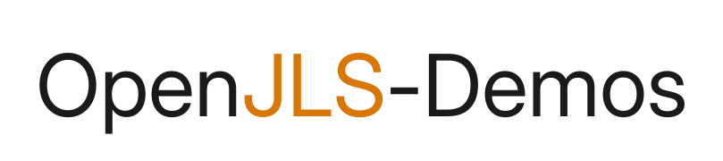
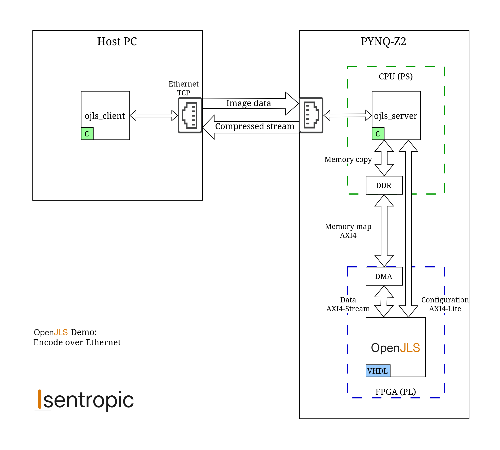

<picture>
  <source media="(prefers-color-scheme: dark)" srcset="Docs/Images/openjls-demos-wordmark-dark.svg">
  
</picture>

Demo projects for [OpenJLS](https://github.com/isentropic-fpga/OpenJLS), the
open-source JPEG-LS (ITU-T T.87) hardware encoder. Each demo has its own
directory and reproduction guide; the core is a shared submodule pinned at the
verified commit.

Core specs, benchmarks and licensing: **[isentropic.com.br/openjls](https://isentropic.com.br/openjls)**

## Encode over Ethernet

[`EncodeOverEthernet/`](EncodeOverEthernet/README.md) — a host sends raw
images over TCP; the board encodes them to JPEG-LS **entirely in the fabric**
and sends the `.jls` files back. The board's CPU never touches a pixel: it only
moves bytes between the socket and an AXI DMA.

The PYNQ-Z2 (Zynq-7020) build ships prebuilt — a bitstream per pixel depth,
the device-tree overlay and the DMA kernel module — so no FPGA toolchain is
needed. The board software uses only generic Linux interfaces (UIO,
u-dma-buf), so porting to another board is a block-design and device-tree job.

### Outcome

On a PYNQ-Z2, the whole OpenJLS golden corpus — **5639 images at every pixel
depth 8–16**, including the full-size originals too large to simulate — encodes
**byte-exact against the CharLS reference encoder**.

This sweep is the hardware-in-the-loop row of the core's
[verification report](https://isentropic-fpga.github.io/OpenJLS/), next to its
OSVVM, golden-model and post-synthesis suites.
[`EncodeOverEthernet/README.md`](EncodeOverEthernet/README.md) reproduces it
from a clean clone.

## Repository layout

| Path | What |
|---|---|
| [`EncodeOverEthernet/`](EncodeOverEthernet/README.md) | The demo above: software, PYNQ-Z2 hardware build, verification. Other boards go beside `Hardware/pynq-z2/`. |
| `ThirdParty/OpenJLS` | The encoder core (submodule); owns the image corpus and the CharLS reference the verification uses. |

## About

OpenJLS and these demos are maintained by
[Isentropic](https://isentropic.com.br), an FPGA engineering company.
Licensing, technical questions or collaboration:
[isentropic.com.br/contact](https://isentropic.com.br/contact) or
contact@isentropic.com.br
